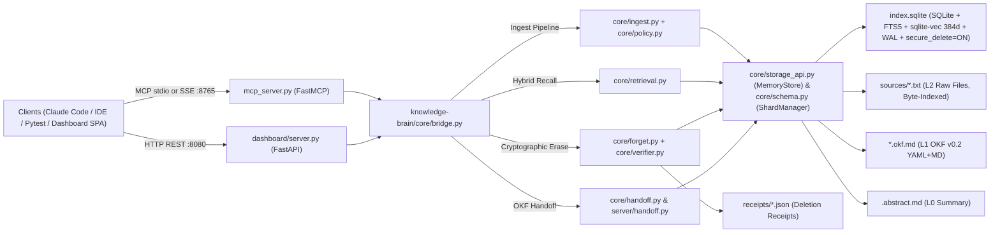
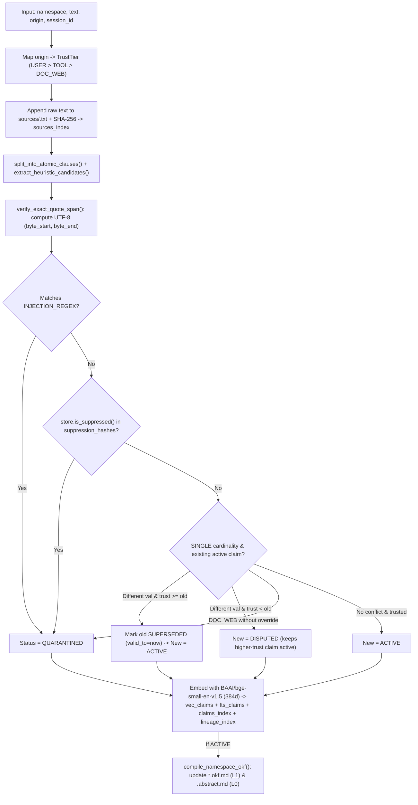
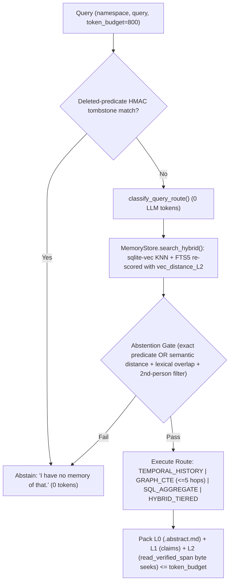

# TraceZero (Knowledge Brain) — Complete System & Dataflow Guide

This document explains how TraceZero works in **simple English** first, followed by the **in-depth technical dataflow** across ingestion, hybrid retrieval, cryptographic unlearning, quarantine governance, and cross-agent OKF v0.2 handoffs.

---

## Part 1: Simple English — The Big Picture

Think of a conventional AI memory tool as throwing every conversation into one giant vector database and hoping similarity search picks the right chunk later. That approach breaks down when:
- Different employees or engineering projects share similar terms (cross-tenant/project leakage),
- Facts change over time (`PostgreSQL 14` → `PostgreSQL 16`, or relocation `Mangaluru` → `Bengaluru`),
- An untrusted web snippet or doc contains hidden instructions trying to poison agent memory, or
- A user demands complete, verifiable deletion of a secret ("forget `OrionVault#2026!` forever").

**TraceZero (Knowledge Brain)** solves this by giving every namespace (e.g., `acme_corp/users/emp_042`) its own **isolated directory ("micro-shard")** containing three clean memory layers:

1. **L0 — Identity Summary Card (`.abstract.md`)**: ~50–100 tokens summarizing key active facts for that entity.
2. **L1 — Structured Fact Sheets (`*.okf.md` + `index.sqlite`)**: Extracted `(subject, predicate, object_val)` claims with provenance links, trust tiers (`USER > TOOL > DOC_WEB`), and temporal validity (`active` vs. `superseded` vs. `disputed` vs. `quarantined`).
3. **L2 — Verbatim Receipts (`sources/*.txt`)**: Raw session transcripts and documents stay on the filesystem as plain `.txt` files. **No large raw text blobs are duplicated inside `claims_index`** — instead, each claim stores exact UTF-8 byte offsets (`byte_start`, `byte_end`) pointing to the verbatim quote on disk.

### How Each Operation Works Everyday

- **Remembering (`remember`)**: Breaks messages into single atomic claims, catches prompt injections or untrusted overwrites (quarantining or disputing them), automatically expires old values (`valid_to`) when a higher/equal-trust source updates a single-valued attribute, writes raw text to `sources/*.txt`, updates SQLite indexes (structured + FTS5 + vector embeddings), and recompiles L0/L1 Markdown views.
- **Recalling (`recall`)**: Uses a deterministic **0-LLM-token router** to detect what kind of question is being asked (temporal history, multi-hop graph dependency, count/aggregate, or hybrid lookup), searches *strictly inside that namespace shard*, blocks deleted or weak/trick matches (*"I have no memory of that."*), and packs L0 + L1 + exact byte-seeked L2 quotes within your `token_budget`.
- **Explaining & Auditing (`explain`, `history`)**: Jumps directly to `(byte_start, byte_end)` in `sources/*.txt` to prove where a claim came from, or displays the chronological chain (`Mangaluru [superseded]` → `Bengaluru [active]`).
- **Forgetting (`forget`, `verify_deletion`)**: Records one-way HMAC cryptographic tombstones (so the deleted secret can never be re-learned or recalled via paraphrase), overwrites the exact bytes in `sources/*.txt` on disk with `[REDACTED]` / `[REDACTED_BY_USER]`, deletes matching records across SQLite/FTS5/vectors, runs `PRAGMA secure_delete = ON` + `VACUUM` + WAL truncation to wipe freed SQLite pages, scans every file in the shard byte-by-byte to confirm **0 bytes remain**, and saves a `DeletionReceipt` JSON with post-scrub SHA-256 hashes.
- **Cross-Agent Handoffs (`handoff_create`, `handoff_get`)**: Compiles active decisions, goals, completed/pending steps, and verified citations into a compact `tasks.okf.md` file. Another agent (even after a full server process restart) can read it and get `stale_warnings` automatically if any relied-upon fact has since been superseded or deleted.

---

## Part 2: In-Depth Technical Dataflow

### End-to-End Architecture Overview

---

### 1. Storage Topology & Physical Tenant Isolation

Implemented in `knowledge-brain/core/schema.py` (`ShardManager`):

- `ShardManager.get_shard_dir(namespace)` isolates each namespace into its own filesystem folder: `memory_root/<namespace>/` (e.g., `memory_root/acme_corp/users/emp_042/`).
- Every SQLite connection opened via `ShardManager.get_connection(namespace)`:
  - Loads `sqlite_vec` (`vec0`)
  - Enables `PRAGMA journal_mode = WAL;`
  - Enables `PRAGMA secure_delete = ON;`
  - Enables `PRAGMA foreign_keys = ON;`
- Core schema per shard (`index.sqlite`):
  - `sources_index(source_id, file_path, sha256_hash, origin, trust_tier, created_at)`
  - `entity_aliases(alias, canonical_subject)`
  - `claims_index(claim_id, namespace, subject, predicate, object_val, status, valid_from, valid_to, source_id, byte_start, byte_end, okf_file)`
  - `lineage_index(claim_id, vec_rowid, fts_rowid, okf_file)` *(Note: `bridge.remember` / `dashboard/server.py` inspect table columns via `PRAGMA table_info(...)` so both `MemoryStore` shards and bridge-initialized shards interoperate cleanly.)*
  - `suppression_hashes(fact_hmac, deleted_at)`
  - `fts_claims` (`USING fts5(subject, predicate, object_val)`)
  - `vec_claims` (`USING vec0(embedding float[384])`)

---

### 2. Write / Ingestion Flow (`ingest_message` & `bridge.remember`)

Implemented in `knowledge-brain/core/ingest.py`, `knowledge-brain/core/policy.py`, `knowledge-brain/core/storage_api.py`, and `knowledge-brain/core/okf_compiler.py`.

Step-by-step details:

1. **Origin Trust Assignment** (`contracts.py`):
   - `ORIGIN_TRUST_MAP` maps `user` / `user_session` / `agent_interaction` → `TrustTier.USER (3)`, `tool` → `TrustTier.TOOL (2)`, `doc` / `web` / `external_untrusted` / `untrusted_scrape` / `poisoned` → `TrustTier.DOC_WEB (1)`.
2. **L2 Disk Write First**:
   - `ingest_message()` calculates `base_byte_offset` on `sources/<session_id>.txt` and calls `store.save_source()` (`ShardManager.append_raw_source`), storing only file path + SHA-256 metadata in `sources_index`.
3. **Atomic Clause Splitting & Candidate Extraction**:
   - `split_into_atomic_clauses()` divides multi-sentence/compound user utterances cleanly (e.g., splitting `"and I live in..."`).
   - `extract_heuristic_candidates()` extracts canonical `ExtractedCandidate(subject, predicate, object_val, exact_quote)` items registered in `PREDICATE_REGISTRY` (`contracts.py`) — e.g., `favorite_color`, `lives_in`, `preferred_db`, `aws_region`, `deployment_env`, `vault_passphrase`, `depends_on`, `manages`, `works_on`, `decided`, `constraint`, `task_goal`, `task_completed`, `task_pending`, or fallback `has_note`.
4. **Verbatim Byte-Span Verification** (`policy.verify_exact_quote_span`):
   - Finds `exact_quote` inside `text` and computes UTF-8 `(byte_start, byte_end)`. Candidates without a verbatim substring match are rejected.
5. **Security Policy & Conflict Resolution** (`policy.apply_policy_and_decide_status`):
   - Checks `INJECTION_REGEX` across `raw_quote`, `object_val`, and `full_text` → `ClaimStatus.QUARANTINED`.
   - Checks `store.is_suppressed()` (`HMAC-SHA256` in `suppression_hashes`) → blocks re-ingestion (`QUARANTINED`).
   - Checks `Cardinality.SINGLE` slots (`predicates.is_single_valued`): supersedes lower/equal-trust active values (`valid_to = now`), marks lower-trust contradictions as `DISPUTED`, and quarantines untrusted `DOC_WEB` claims pending confirmation.
6. **Multi-Index Storage & OKF Compilation** (`MemoryStore.store_claim`):
   - Resolves subject aliases via `entity_aliases`.
   - Formats `semantic_text`: `f"{subject}: {object_val}"` for `has_note`/`stated`, otherwise `f"{subject} {predicate} {object_val}"`.
   - Embeds with `fastembed.TextEmbedding("BAAI/bge-small-en-v1.5")` (384-d `float32`) and inserts into `claims_index`, `fts_claims`, `vec_claims`, and `lineage_index`.
   - Calls `compile_namespace_okf()` to rebuild `preferences.okf.md`, `decisions.okf.md`, `notes.okf.md`, and `.abstract.md`.

---

### 3. Read / Recall Pipeline (`recall_context` & `bridge.recall`)

Implemented in `knowledge-brain/core/retrieval.py` and `knowledge-brain/core/storage_api.py`.

Step-by-step details:

1. **Zero-LLM Query Router (`classify_query_route`)**:
   - Routes queries deterministically (`0` LLM tokens) to:
     - `TEMPORAL_HISTORY` (history, changes, past/superseded values)
     - `GRAPH_CTE` (dependency/management chains/hops)
     - `SQL_AGGREGATE` (counts/tallies)
     - `HYBRID_TIERED` (default).
2. **Deleted-Predicate Tombstone Gate**:
   - Scans `suppression_hashes`. If the query asks about a `PREDICATE_KEYWORDS` slot that currently has no active claims and has a `__deleted_predicate__` HMAC tombstone, immediately abstains.
3. **Hybrid KNN + FTS5 Search (`MemoryStore.search_hybrid`)**:
   - Runs vector KNN (`vec_claims WHERE embedding MATCH ? AND k = 18`) and merges FTS5 prefix matches (`fts_claims MATCH ?`) scored using `vec_distance_L2(v.embedding, ?)`.
4. **Abstention Gate & Attribution Filters**:
   - **Sensitive/Secret Queries** (`vault`, `secret`, `password`, `passphrase`, `token`, `credential`, etc.): enforce tight L2 distance (`<= 0.68` or `<= 0.80` with strong non-generic overlap) so deleted-secret paraphrase probes cannot accidentally match nearby operational notes.
   - **Subject-Anchored Attribution Guard (`_is_second_person_attribution`)**: prevents second-person compliments or questions (e.g., Speaker A saying *"Where did you go?"*) from mis-attributing Speaker B's activity to Speaker A.
5. **Route Execution & Multi-Hop Graph**:
   - `TEMPORAL_HISTORY`: retrieves `active` + `superseded` claims sorted by `valid_from ASC`.
   - `GRAPH_CTE`: runs `MemoryStore.query_graph_multihop()` using a recursive SQLite CTE (`WITH RECURSIVE graph_walk`) joining `c.subject = LOWER(g.object_val)` up to 5 hops (`hop < 5`).
   - `HYBRID_TIERED`: prioritizes active structured predicates first, falling back to vector/FTS hits plus adjacent source-file context notes (`rowid +/- 1` for non-sensitive queries).
6. **Budgeted 3-Tier Packing (`cl100k_base`)**:
   - Prepends `.abstract.md` (L0), adds L1 claim bullets, seeks exact L2 byte slices on disk via `store.read_verified_span()`, and enforces `token_budget` using `tiktoken` (`cl100k_base`).

---

### 4. Cryptographic Unlearning & Byte Verification (`forget_target` / `verify_deletion`)

Implemented in `knowledge-brain/core/forget.py`, `knowledge-brain/core/verifier.py`, and `knowledge-brain/core/bridge.py`.

1. **Target Matching**: Locates matching claims in `claims_index` (by predicate, `object_val` substring, `claim_id`, or subject) plus optional vector neighbors (`distance < 0.65` in `forget_target`).
2. **Tombstone Insertion**: Stores `HMAC-SHA256` suppression hashes (per-fact `subject|predicate|object_val` and `__deleted_predicate__` / query target HMAC) in `suppression_hashes`.
3. **Physical Source Redaction**: Opens raw `sources/*.txt` files in `"r+b"` mode, seeks directly to `(byte_start, byte_end)` (or replaces target byte sequences in `bridge.forget`), overwrites the exact bytes with `[REDACTED]` / `[REDACTED_BY_USER]`, executes `flush()` + `os.fsync()`, and updates `sources_index.sha256_hash`.
4. **Cascade Purge & SQLite Page Scrubbing**:
   - Deletes entries from `vec_claims`, `fts_claims`, `lineage_index`, and `claims_index`.
   - Rebuilds FTS5 (`INSERT INTO fts_claims(fts_claims) VALUES('rebuild');`).
   - Runs `PRAGMA wal_checkpoint(TRUNCATE);`, `PRAGMA secure_delete = ON;`, and `VACUUM;` to overwrite and reclaim freed B-tree pages and WAL frames.
5. **OKF Recompile, Byte Scan & Verification Receipt**:
   - Calls `compile_namespace_okf()` so deleted values vanish from `*.okf.md` and `.abstract.md`.
   - Runs `scan_shard_bytes(shard_dir, forbidden_strings)` across every file in the shard directory (`index.sqlite`, `-wal`, `*.okf.md`, `sources/*.txt`).
   - Computes SHA-256 checksums across all surviving shard files (`compute_shard_hashes`) and returns a `DeletionReceipt` (persisted under `receipts/*.json` via `bridge.forget`).
   - `verify_deletion()` independently asserts `0` SQLite byte matches, `0` filesystem byte matches, suppression hash presence, and 10/10 abstained verification probes.

---

### 5. Cross-Agent OKF v0.2 Task Handoff (`handoff_create` & `handoff_get`)

Implemented in `knowledge-brain/core/handoff.py` and `knowledge-brain/server/handoff.py`:

- **`handoff_create`**: Queries `status = 'active'` structured claims from `index.sqlite`, resolves byte-verified L2 source quotes via `read_verified_span()`, writes `tasks.okf.md` with YAML frontmatter (`okf_version: "0.2"`, `relied_on_claims`, `sources`, `status`, `created_by_agent`) + Markdown goal/steps/citations, and computes `handoff_tokens` vs. `full_history_tokens`.
- **`handoff_get`**: Reads `tasks.okf.md` and `.abstract.md` cleanly from disk (surviving full OS process restarts), then cross-checks every ID in `relied_on_claims` against `index.sqlite`, surfacing `stale_warnings` if any dependency was superseded, disputed, or deleted.

---

## Part 3: Benchmark Seeding & Live Inspection Pipelines

- **Enterprise Seeder (`knowledge-brain/evals/seed_30_sessions.py`)**: Deterministically (`random.seed(42)`) generates 20 projects, 100 isolated employee shards (`emp_001..emp_100`), 30 sprint sessions for `emp_042` on `orion_payments` (`17,539` tokens), exports `dataset.json` + `enterprise_shared_feed.jsonl`, and seeds fresh shards under `memory_root/` and `knowledge-brain/memory_root/`.
- **Mem0 Baseline Seeder (`knowledge-brain/evals/seed_mem0.py`)**: Wipes `~/.mem0` and ingests the exact same 115 records from `enterprise_shared_feed.jsonl` for side-by-side comparison.
- **Dashboard (`dashboard/server.py`)**: Exposes live HTTP audit endpoints over the seeded shards so L0/L1/L2 tiers, claim statuses (`active`, `superseded`, `disputed`, `quarantined`), binary byte scans, and 5-strategy benchmarks can be inspected in real time.
